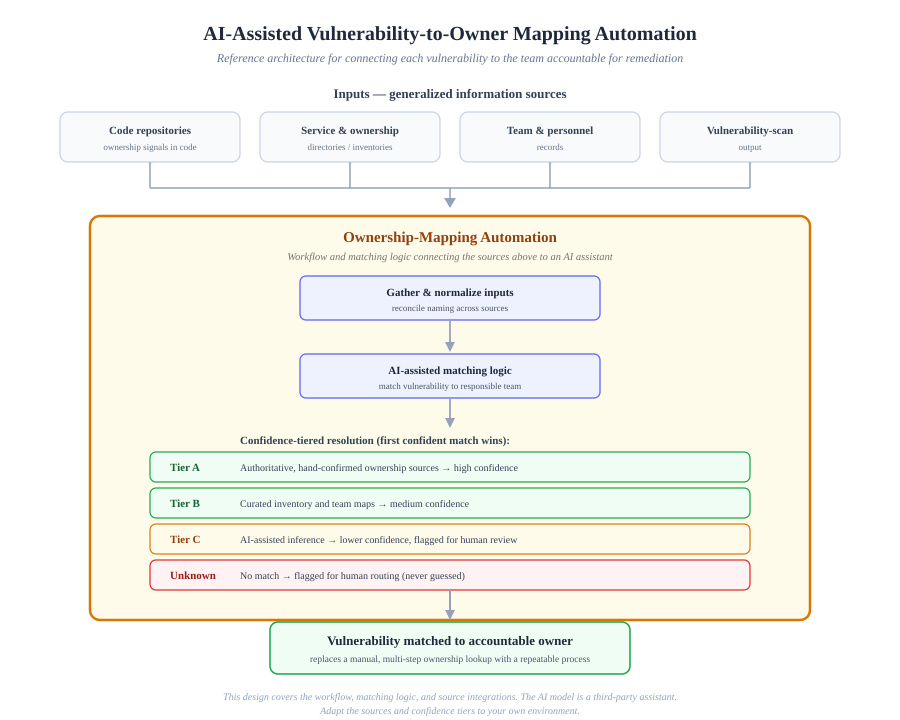

# Connecting Findings to Accountable Owners

A finding that no one owns doesn't get fixed. In my experience, the single biggest reason remediation stalls isn't technical difficulty — it's that the finding never reaches the person accountable for it, or reaches the wrong one. Reliable ownership information is the foundation that makes prioritization and remediation actually work.

## How to connect a finding to its owner

1. **Read what the finding gives you.** Detection tools — whether they use an agent inside your systems or are fed your system, application, and host data — surface a finding with details. The title and affected-asset fields usually contain identifying information: an application or service name, a repository, a host.

2. **Extract the identifier.** Parse or pull that identifying information out of the finding.

3. **Look it up in your inventory.** Take the identifier to your inventory of applications and owners, search for the match, and get the responsible team and point of contact. Many organizations maintain this in a configuration management database (CMDB) that lists applications and their owners; ideally you have one.

4. **Route it to the owner** with the context they need — what the finding is, its priority and why, and what's expected.

## When ownership is unknown

Not every finding maps cleanly, and not every organization has a complete inventory. When ownership isn't clear:

- Escalate — ask your manager or team lead.
- Investigate — look for the closest match, or find someone who can point you to whoever owns the affected system.
- Follow the chain — often the fastest path is one person who knows who *actually* owns it.

Define a default holder so nothing sits ownerless while you track down the real owner.

## Keeping ownership current

Ownership drifts as teams reorganize and applications are retired or handed off. Ways I keep it usable:

- Map each application to a team or role alias (for example, a team distribution list), not an individual's name, so ownership survives staff changes.
- Reach out to the previous owner when a mapping is stale.
- Refer to a maintained team directory or team-leadership records when the inventory is incomplete.
- Where a CMDB exists, keep it as the source of truth and refresh (document) it on a defined cadence.

Be honest that this is often a known pain point — inventories are rarely perfect, and staleness is a constant.

## Automating the process with AI

Mapping a finding to its owner by hand is repetitive and involves juggling several sources at once — the finding's details, the code repositories, team directory. It's exactly the kind of many-tabs, error-prone lookup worth automating.

The main approach I developed to solve the ownership problem:

- create an agentic workspace that maps ownership to each vulnerability for you
- connect your ownership sources (such as a CMDB, application inventory, and team directory) to an AI agent approved by your organization
- connect your scanning tools to the agent so it has the vulnerability details
- gather and normalize the inputs, reconciling how each source names the same application, repository, or team
- have the agent resolve each finding to the affected component's owning team and point of contact
- keep the judgment (validation, prioritization, resolving disputes) with people, and let automation handle the mechanical matching and routing

*Reference architecture for this approach. The specific sources, confidence tiers, tools, and integrations will depend on your environment, so adapt it rather than copying it exactly.*

## Resolve by confidence, not by guess

Not every match is equally reliable. Resolve each finding against your sources in order, and let the first confident match win:

| Tier | Source | Confidence | Action |
|---|---|---|---|
| A | Authoritative, hand-confirmed ownership records | High | Route automatically |
| B | Curated inventory and team maps | Medium | Route automatically |
| C | AI-assisted inference | Lower | Flag for human review |
| Unknown | No match | None | Route to the default holder for investigation |

Automation should never guess an owner. A wrong route wastes a team's time and leaves the real owner unaware.

## Common failure modes to design against

- **Orphaned findings** — the finding maps to no owner.
- **Stale ownership** — the mapped team no longer owns the asset. 
- **Shared components** — affects many applications. Who owns the fix?
- **Ambiguous boundaries** — two teams each think the other owns it.
